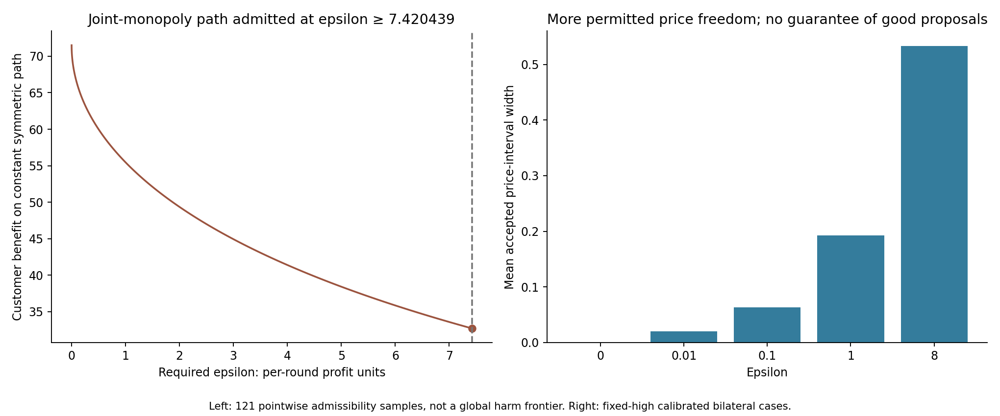

# Pricing receiver contracts: a conditional guarantee and its boundaries

**A trusted action constraint can recover competitive prices in this known two-firm economy, but only under explicit adoption and model assumptions.** Exact bilateral enforcement converges to the stage-game Nash outcome; unilateral enforcement, releasing the contract, incorrect demand, and a large permitted profit loss expose different limitations. This is a mathematical and adversarial benchmark, not a finished empirical AI-collusion study.

## Motivation and contribution

The first scripted study established a mechanical null: deleting strategic text cannot stop a controller that carries the same convention through price history. That is a useful explanatory control, but insufficient substantive research on its own. The new study retains information and instead constrains what action can execute after a handover.

The contribution is a precisely stated receiver contract, an elementary specialized finite-time bound with explicit positive-tolerance conditions, a pointwise high-price admissibility threshold, and reproducible adoption/model-error counterexamples. Best-response convergence and action shielding are prior work. We do not claim a first-ever algorithm or general collusion prevention.

Closest prior art includes [action shielding](https://arxiv.org/abs/1708.08611), [logit price-equilibrium contraction arguments](https://faculty.wharton.upenn.edu/wp-content/uploads/2016/10/5-Price-Competition-Under-Multinomial-Logit-Demand-Functions-with-Random-Coefficients.pdf), and [calibrated-regret audits](https://arxiv.org/html/2501.09740). The proposed per-round loss certificate is not calibrated regret. [Algorithmic Collusion Without Threats](https://drops.dagstuhl.de/entities/document/10.4230/LIPIcs.ITCS.2025.10) also warns that generic no-regret or no-threats arguments do not ensure competitive outcomes. A fuller comparison is in [NOVELTY_REVIEW_V2.md](NOVELTY_REVIEW_V2.md).

## Contract and checked mathematical claim

For previous rival price q, let b(q) maximize the seller's one-round modeled profit. Accept prices p satisfying `profit(b(q),q) - profit(p,q) <= epsilon`, then project any proposed price to that closed interval. Epsilon is additive per-round profit in the 100-buyer economy. The guard runs outside editable inherited memory on every protected round; it does not ask a proposer to obey a note.

In the exact calibrated logit economy, the best-response derivative is below 1/2. If both firms remain protected and epsilon=0, the joint map is a contraction and maximum price error satisfies `e_t <= (1/2)^t e_0`. This is a specialization of classical best-response contraction, not a new general convergence theorem.

For positive epsilon, log-profit curvature gives an action-distance bound. For arbitrary initial prices in [0,3], the derivation requires `epsilon < P0 = 0.1672655373`. After one protected round, the stronger above-cost lower profit bound `P1 = 6.6346982193` applies, with `delta(P) = sqrt(8 log(P/(P-epsilon)))`. The first-step error uses delta(P0), later steps delta(P1), yielding a finite-time neighborhood bound and limiting price bound `2 delta(P1)`. This can be coarse. Merely requiring epsilon below P1 does not justify entry into the above-cost regime from arbitrary initial prices.

The full derivation, including endpoint existence, exact derivative bound, bootstrap condition, and consumer-benefit floor, is [RECEIVER_CONTRACT_MATH.md](RECEIVER_CONTRACT_MATH.md). The mathematics is elementary analytic reasoning with independent review, not a machine-checked proof. Simulations check implementation consistency and cannot prove an arbitrary-proposal theorem by themselves.

## A useful uniform-initial corollary

The general bound also gives a concrete, conservative guarantee. Set epsilon to **0.005 profit units**. For **every** completed initial pair in [0,3]² and **arbitrary proposals**, if both firms are continuously constrained under the exact calibrated economy, then from the **sixth guarded round onward**, modeled customer benefit is at least **54.112194**. The bound improves afterward toward a limiting floor of 57.180891.

For comparison, the midpoint between the Nash and joint-monopoly customer-benefit references is **52.108788**. Thus the sufficient bound recovers at least half the **Nash-versus-monopoly reference harm**, regardless of initial prices. This does **not** mean half the actual initial harm for every starting pair: that quantity can differ or even be absent. Six rounds is a sufficient bound, not a proven minimum settling time.

This is an **analytic corollary, not a newly simulated epsilon-.005 case**. That epsilon was listed in the pre-evaluation analytic-curve manifest. Its tolerance is only **0.022429% of Nash per-seller profit**, which sharply limits price-proposal freedom. The guarantee assumes authenticated previous prices, correct cost/demand, persistent bilateral enforcement, and ideal real-arithmetic accepted sets; the floating-point implementation is checked separately. Its opportunity-loss constraint concerns the previous rival quote, not its simultaneous current action.

The derivation uses uniform initial error 1.527073340, first-step bound 1.256271738, later disturbance bound 0.077660692, and contraction factor 1/2; the sixth-round price-error bound is 0.189726083. Exact reproducible quantities and assumptions are in [corollary.json](contract-results/corollary.json). This specializes known contraction mathematics into a useful stated guarantee; it does not establish a new general equilibrium theorem.

## Design and scope

The frozen [CONTRACT_PROTOCOL.md](CONTRACT_PROTOCOL.md) specifies 2,160 main nominal configurations and 14 supplementary rows: 12 longer-horizon checks and two wrong-demand cases. The calibrated wrong-model reference is reused. There are 758 effective labeled configurations, 683 distinct executed price paths, and 62,080 settled rounds. Repeated seed labels, unused no-coverage epsilon/release factors, and shared trajectories are not independent samples.

The main grid crosses epsilon {0, .01, .1, 1, 8}, coverage {none, A, both}, release {never, after 5, after 20}, fixed-high/oscillating/random proposals, four fixed initial price vectors, and four seed labels. Main horizon is 80; selected calibrated checks extend to 200. Random proposals use separate reproducible streams for A and B. No model-player inference, learning, RL training, or paid resources were used. Earlier LLM pilots are outside this study.

All 84 effective configurations inside the theorem's stated numerical-check regime satisfy the finite-time inequalities to tolerance 1e-7. The summary records no positive maximum bound residual; maximum acceptance violation is approximately `1.56e-15` profit units. These are floating-point diagnostics, not formal numerical certification.

## Assumption counterexamples

The following predeclared cases all propose the joint-profit price and start at that price. Figures and table use the **last 20 rounds**, avoiding confusion with transient whole-horizon averages. True mu remains .25 in every row.

| Case | Price A | Price B | Customer benefit | Case ID |
|---|---:|---:|---:|---|
| No contract | 1.924981 | 1.924981 | 32.707805 | contract-0002 |
| Only A protected, epsilon 0 | 1.661695 | 1.924981 | 45.693567 | contract-0146 |
| Both permanently protected, epsilon 0 | 1.472927 | 1.472927 | 71.509771 | contract-0290 |
| Both protected only through round 5 | 1.924981 | 1.924981 | 32.707805 | contract-0338 |
| Both protected only through round 20 | 1.924981 | 1.924981 | 32.707805 | contract-0386 |
| Both permanent, believed mu .20 | 1.390917 | 1.390917 | 79.307269 | contract-2173 |
| Both permanent, believed mu .50 | 1.799471 | 1.799471 | 42.438562 | contract-2174 |
| Both permanent, epsilon 8 | 1.924981 | 1.924981 | 32.707805 | contract-2018 |

Protecting A alone improves customer benefit but leaves B's price high and does not reach symmetric Nash. A earns 41.169485 per round against the unprotected high rival, while B earns 20.075932. There is no unilateral market-recovery theorem.

Releasing the guard allows the fixed-high proposal to execute immediately again, after either 5 or 20 protected rounds. The guarantee belongs to persistent constraints, not to the act of restarting a seller or transferring a clean packet.

Wrong demand can harm either business competence or customer welfare. Believed mu .20 produces lower prices and A-profit 18.726725, below true Nash profit 22.292666. Believed mu .50 produces higher prices and customer benefit 42.438562, far below true Nash benefit 71.509771. Passing the believed-model acceptance rule does not certify true-model performance.

## Price freedom and the high-price threshold

Epsilon=0 leaves a zero-width permitted set, completely overwriting price proposals. In the selected fixed-high calibrated bilateral case, no proposal remains unchanged. This is an exact best-response controller; it does not demonstrate retained intelligent price-setting autonomy.

Positive epsilon permits inherited information or an adversarial proposal to choose different accepted prices. The exact pointwise threshold for a constant symmetric price p is `r(p) = profit(b(p),p) - profit(p,p)`. If epsilon is at least r(p), repeating p can remain invariant. At the joint-profit price, `r(p) = 7.4204391951`. Thus the epsilon-8 row accepts the high proposal every round with mean adjustment zero and average permitted width 0.533259 price units. Both high prices and their associated customer harm persist despite full coverage.

The plotted 121 points are exact numerical evaluations of a **pointwise constant-symmetric-path condition**. They do not establish the global maximum harm over arbitrary adaptive histories, monotonicity without proof, or equilibrium credibility. High-price permissibility is an adversarial possibility, not a prediction that a real agent chooses it.

The condition `r(p) <= epsilon` is precisely the standard **pure epsilon-Nash condition restricted to the symmetric diagonal** of this stage game. We do not propose a new approximate-equilibrium concept. The useful specialization is the explicit economic threshold and its use as an acceptance/failure boundary for the persistent contract.

## Certificate versus realized opportunity loss

The certificate uses the last rival price because simultaneous current prices are unknown. In case contract-0290, modeled true lagged-price loss is zero throughout, but maximum one-step loss against the actual current rival price is 1.174467 profit units during the transition. This difference appears even with correct demand and exact bilateral guards. The two quantities must not share an unqualified “regret” label.

The wrong-mu .50 case additionally has maximum true lagged-price loss 3.683900 and current-price loss 4.376190 despite exact optimization in its believed model. Time-reference error and model error are separate limitations.

The analytic neighborhood bounds are conservative: the accepted freedom grows quickly with epsilon, and certified customer-benefit floors may be much weaker than selected observed paths. The plot distinguishes sufficient guarantees from observed behavior. Numerical convergence at epsilon 1 or 8, or under a wrong model, cannot be credited to the small-epsilon accurate-model theorem.

## Separate post-hoc audit of already-recorded LLM proposals

This supplement reuses the earlier pilot; it makes no new model requests. Of
270 recorded formation/continuation quotes, 267 contain a visible previous rival
quote. Three first decisions after minimal handover have no such reference and
are retained but excluded from contract calculations. The records cover 135
paired settlements, seven base episodes and 12 dependent continuation branches.
The 72 earlier fixed-checkpoint probes are excluded.

At epsilon 0, .01, .1, 1 and 8, respectively, the contract would adjust
267, 255, 186, 166 and 93 of the 267 auditable proposals at their recorded states.
Exact-zero counts include price-rounding deviations; being adjusted does not
identify a quote as collusive. The saved strata distinguish model, disclosed
demand, original objective, current receiver objective, stage and handover arm.

This is a descriptive intervention-burden audit. It does not rerun the agents,
predict the following state, demonstrate a protected trajectory, or establish
semantic filtering efficacy. The original 342 pilot decisions consumed included
Codex allowance earlier; this audit consumes none. Outputs exclude raw notes,
account metadata and thread identifiers. See [the audit protocol](HISTORICAL_AUDIT_PROTOCOL.md),
[sanitized summaries](historical-audit/summary.json), and
[independent review](REVIEW_ROUND_4.md).

## Reproduction, audit, and limits

Run `python research/analyze-contract-study.py` to regenerate three standalone figures, [selected cases](contract-results/selected-cases.csv), and [browser data](contract-results/contract-data.js) from `.local/receiver-contract-v1`. The complete compact data retain all 2,174 rows with their configuration and metrics. The frozen manifest timestamp is `2026-10-24T20:08:53.282Z`; its SHA-256 is `6c9a60dc682f54b847787abea133fea31d0cdcee5626d56220dcc2382732d94f`.

The analysis verifies manifest identity and row counts. The completed independent audit (`.local/receiver-contract-v1/audit.json`, auditor `research/audit-contract-study.js`) **passed 2,694,541 checks**, recomputing all **62,080 settled rounds** and **124,160 accepted intervals**. It checked proposals/PRNG streams, projections, lagged and current loss, metrics, theoretical bounds, grid/deduplication, hashes, all 12 long-prefix comparisons, and sampled thresholds. Maximum independent interval-endpoint disagreement was approximately **2.11e-14** price units. This is a numerical implementation audit plus a separately reviewed real-arithmetic derivation, not a formal floating-point certificate or evidence about learned agents.

This strengthens the original mechanical-null study by supplying an enforceable, quantified statement and explicit failure boundaries. Its narrowness remains substantial: exact fixed demand, known cost, two single-product firms, authenticated last prices, synchronous decisions, uninterrupted guard execution, and synthetic proposal families. It does not solve market-wide anti-collusion under unilateral adoption, learn a demand model, prove robust semantics of memory, or establish real LLM behavior. A theory-plus-stress benchmark is the current substantive result; priority and competition rank are not established. No presentation was created.
