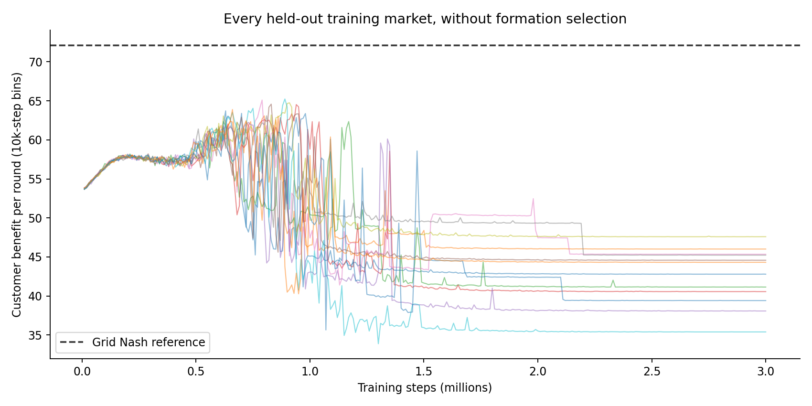
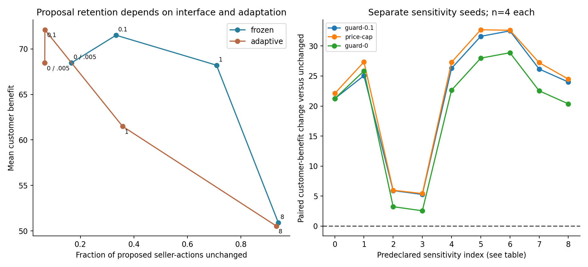

# Learned pricing: welfare improves while most proposals are corrected

**Follow-up interpretation:** [CREDIT_RESULTS.md](CREDIT_RESULTS.md) compares
actual action interfaces and longer continuation. Feasible-aware learning
raises retention to 100% without widening the near-singleton price set. The
cap's early welfare lead largely vanishes later. The results below remain
the original prospectively specified study; retention is interface-dependent,
and its failure is not an interface-invariant finding about agent autonomy.

**The practical advantage predicted for the receiver contract failed.** Local profit-seeking Q-learners developed persistent above-reference pricing in all 12 independently seeded runs. A bilateral epsilon-.1 guard increased customer benefit substantially, but changed about 93% of proposed seller-actions during adaptation. A simple competitive-price cap delivered more customer benefit while retaining about five times as many proposals. The evidence supports a quantified limitation of this guard/learning architecture, not a uniquely successful anti-collusion method.

## Question, method, and prospective changes

The primary question was whether a persistent positive-tolerance guard could improve customer benefit **and** retain useful price discretion relative to simpler controllers. The practical gate required a customer-benefit improvement of at least 5% of the continuous Nash–joint-monopoly gap (1.940098 model units) and retention of at least 20% of proposed actions. The epsilon-.1 adaptive contrast was fixed before training; every seeded run remains included.

The [protocol](LEARNING_PROTOCOL.md) preceded learner implementation; a [prospective amendment](LEARNING_PROTOCOL_AMENDMENT.md) fixed the actual bounded run before its main manifest. Main seeds1001–1012 each trained two private tabular learners for3m simultaneous rounds. State was the last executed grid-price pair, actions15 prices, own profit the reward, alpha.15, gamma.95, and training exploration exp(−4e−6 t). Initial Q values reflected uniformly random rivals, not an instruction to cooperate. Both current decisions were sealed before settlement. No LLM, API, paid compute, or semantic note reader was used.

Twelve competence controls trained A against a fixed competitive rival for equal own-update budgets;12 markets trained with a bilateral .1 guard from the start;36 markets covered nine declared sensitivities on four separate seeds each. Total main-study training:72 market labels×3m steps=216m training rounds. These are not72 independent replications of the primary contrast: its unit is the12 independently seeded base markets.

Frozen evaluation used2,000 rounds without exploration or updates. Adaptive evaluation used20,000 rounds with updates and deliberately restarted .01 exploration. Updating-greedy evaluation separately kept updates but no exploration. The shorter windows were prospectively amended for compute/storage; claims concern short-run deployment, not eventual convergence. The completed study took499.33 seconds, below its900-second budgeting target, and saved1,230 branches and15.63m evaluated settlements.

## Economic grid and formation

The15-price grid runs from continuous PN−.1(PM−PN) to PM+.1(PM−PN). It has **two symmetric pure Nash pairs**, at indices1 and2. The predeclared reference is the lower symmetric equilibrium: price1.466468742, per-seller profit22.020400847, customer benefit72.119040418. Continuous references differ: PN≈1.472927 and PM≈1.924981. The finite-grid guard uses **grid** best-response profit; it does not inherit the earlier continuous contraction theorem.

All12 base markets pass the basic harmful-profitable-pricing screen in each of the five terminal10k training windows and in a separate frozen evaluation: both prices/profits exceed the grid reference and customer benefit is lower. That establishes learned supracompetitive pricing under this finite protocol. It does not establish intent, legal collusion, subgame perfection, or general prevalence. The screen was not used to select markets for treatment comparisons. Checkpoints at1m/2m/3m and cycle diagnostics are retained rather than selecting a favorable instant.

## All-market comparisons

Values are means across all12 base markets. Customer benefit is model consumer surplus per round. “Retained” counts **all seller proposals**, including uncovered sellers in unilateral arms; it is not a protected-actions-only statistic. Main bilateral comparisons have no such denominator ambiguity.

| Intervention | Frozen customer benefit | Adaptive customer benefit | Adaptive proposals retained |
|---|---:|---:|---:|
| Unchanged |42.5416|45.2917|100%|
| Observation reset only |42.5862|45.1460|100%|
| Fresh Q, retained observation |62.2350|61.5295|100%|
| Competitively pretrained successor |62.1496|60.8490|100%|
| Cross-play pretrained successor |66.4673|57.1699|100%|
| Exact discrete guard / grid best response |68.4716|68.4768|6.71%|
| Discrete guard epsilon.005 |68.4716|68.4768|6.71%|
| Discrete guard epsilon.1 |71.5114|72.1143|6.75%|
| Discrete guard epsilon1 |68.2162|61.4994|35.76%|
| Discrete guard epsilon8 |50.9016|50.5309|93.25%|
| Fixed nearest-continuous-Nash grid price |72.1190|72.1190|6.73%|
| Cap at that competitive grid price |72.3835|73.1873|33.63%|

The primary paired improvement is **26.822616 customer-benefit units**. Whole-market paired bootstrap intervals and every per-seed effect are in [primary.csv](learning-results/primary.csv) and [per-market.csv](learning-results/per-market.csv), with10,000 resamples and fixed analysis seed20261025. Rounds and branch checkpoints do not enlarge n. Cross-play shares donor markets, so it is reported descriptively without an inappropriate independent-branch interval.

The primary95% paired bootstrap interval is **[25.3820,28.3111]**; it describes variation across this small fixed collection of seeded training markets, not market-population prevalence. The mean accepted-action fraction under adaptive guard.1 is **6.6742%**, about one of15 grid actions, alongside mean absolute correction0.236689 price units. The practical failure therefore involves both actual correction burden and a narrow accepted price set, while retention itself remains interface-dependent.

The .1 guard passes the welfare component but **fails the20% retained-proposal requirement**. Frozen retention is33.32%; after20k adaptive steps it is6.75%. This distinction is central: immediate frozen-policy performance does not predict the intervention burden after adaptation. Epsilon1 retains more proposals but yields substantially less welfare than the cap. Epsilon8 largely preserves discretion and much of the high-pricing harm.

Tighter tolerance does not monotonically improve welfare here: the exact discrete guard gives adaptive customer benefit **68.4768**, below **72.1143** for epsilon .1. The grid has multiple Nash equilibria, so differing outcomes are consistent with distinct grid attractors or basins. These summaries alone do not prove basin selection caused the difference. They do establish that the continuous contraction result must not be transferred to the discrete learner experiment or used to assert monotonic customer benefit.

The cap is not a free business improvement: adaptive A/B profits are21.5277/21.5227 versus30.8469/31.7967 unchanged and22.0224/22.0224 under guard.1. It favors customers at sellers' expense. This demonstrates an actual welfare/discretion/profit tradeoff, not dominance on every objective. Nor do unchanged proposed actions by themselves prove useful business autonomy.

## What replacement changes

An inherited restart is exactly the unchanged continuation, as expected: restarting an identical Q table and state is a sham intervention. Resetting only the last-price observation produces almost no mean effect. This suggests that one observation alone is insufficient to remove the learned convention in these runs, but does not establish a universal memory mechanism. The reset sentinel is an unusual state and its initialized values remain an alternative explanation for some transient behavior.

Fresh Q and a competence-matched-by-budget warm successor both lower prices and raise customer benefit. Thus a replacement effect is not explained solely by deleting information, and cold-start performance is not the only comparison. Still, the warm controller was trained against a fixed rival; post-study diagnostics found near-zero on-path fixed-rival profit gap but appreciable errors in other state rows. It is not an equally competent adaptive-market replacement in every respect. Cross-play changes the rival training context, a known issue in [Eschenbaum et al.](https://arxiv.org/html/2201.00345); it is not a first-ever replacement result.

## Learning with the guard does not solve proposal discretion

Equal-budget .1-guard-trained sellers yield customer benefit72.1190 while protected. Yet retained proposals are **0% frozen** and approximately **0.0633% adaptive**: the guard almost always corrects them. Releasing it yields customer benefit61.3155 frozen and58.7669 adaptive. This shows that this three-million-step guarded-training protocol does not automatically yield competitive unguarded proposals.

The algorithm learns values for **proposed indices**, with rewards determined by executed prices. Multiple proposals can alias to one executed action. High proposals can therefore receive competent execution rewards without becoming good unguarded actions. This is an architectural/credit-assignment explanation consistent with the implementation, not a proof that aliasing is the sole cause. An executed-action-credit comparison remains a distinct missing test; it cannot be claimed completed from these data.

Proposal retention is **interface-sensitive**, not an invariant measure of useful autonomy. A mask-aware chooser could simply propose accepted actions and raise retention without gaining economically meaningful choice. Alias structure, deterministic ties, and finite training may influence the low retention here. Therefore read it alongside accepted-action fraction, correction distance, both profits, and customer benefit in the complete tables. The primary and per-market tables also report the mean permitted price span: on the uniform grid it is `(accepted count - 1) × grid spacing`, since permitted actions form a contiguous set. Uncovered sellers contribute their full grid span. Continuous diagnostics are excluded from that grid formula. The conclusion rejects the predeclared practical gate for this particular proposal-learning interface; it is not an impossibility theorem for guards or intelligent discretion. No tie-rule tuning or new learner experiment was chosen after seeing these outcomes.

## Boundaries, probes, and robustness

All frozen/adaptive/updating-greedy rows, unilateral protection, short release, wrong-demand/cost, and deviation probes remain in the complete data. Recovery uses five consecutive200-step qualifying windows and reports right-censoring; see [recovery.csv](learning-results/recovery.csv). Forced one-step deviations, their actual sign, and discounted paired profit differences are in [deviations.csv](learning-results/deviations.csv). A forced action can be zero-sized or an increase; a reaction alone is not a coordination proof.

Believed-model opportunity loss against the prior quote, true-model loss there, and loss against the simultaneous current quote are different quantities. The saved lagged/current main metrics compare against available grid alternatives; they are not unconstrained continuous regret or calibrated regret. The continuous diagnostics use exact actual previous quotes and quantize only the Q observation, but include just two predeclared seeds,1,000 steps and a different action interface. Do not pool them into the12-market discrete estimate.

The separate [model-loss derivation](learning-results/model-losses.json) reconstructs all three quantities for **108 wrong-model branches** from saved traces. Its [independent spot audit](learning-results/model-losses-independent-audit.json) checked the three seed-1001 frozen wrong-model branches, covering 6,000 rounds; it did not independently reaggregate the remaining 105 derived summaries. The full main audit separately checked true losses and guard maps across all branches. These scopes must not be conflated.

The nine sensitivities vary grid resolution, discount, exploration decay, memory, and learning rate. Their own unchanged controls and differences are in [sensitivities.csv](learning-results/sensitivities.csv); they use seeds2001–2004 and are not paired main-run replications. A separately frozen zero-initialization extension uses four paired seeds and finds mixed changes in unguarded customer benefit; it is exploratory external robustness evidence, not a replacement main sample. Diagnostic/source artifacts identify which checks are completed and which backlog questions remain.

## Verification, novelty, and strongest honest claim

The independent main audit passed250,232,326 checks over all15.63m evaluation rounds and1,230 branches, replaying Q updates, PRNG draws, and settlement; maximum numerical error was about2.16e−12. Separate diagnostics and initialization audits also passed. This supports implementation consistency, not external validity, successful policy autonomy, or a formal proof about learning.

Prior work already establishes Q-learning pricing, rival-context fragility, ordinary best responses, action shielding, and calibrated-regret auditing: [Calvano et al.](https://www.aeaweb.org/articles?id=10.1257/aer.20190623), [Eschenbaum et al.](https://arxiv.org/html/2201.00345), [Alshiekh et al.](https://arxiv.org/abs/1708.08611), [Hartline et al.](https://arxiv.org/html/2501.09740). We reproduce/adapt these components at smaller bounded scale; no first-ever novelty is claimed.

The strongest supported finding is a **negative practical result**: a guard that improves welfare under learned proposals can depend on sustained action overwriting, and training under that actuator need not restore unguarded proposal competence. Observation-only reset is weak here, policy replacement matters, and an ordinary cap provides a stronger welfare/retention baseline while imposing business-profit costs. This is more substantive than the original scripted null but remains a small model-specific learning benchmark, not a proven general defense or guaranteed competition-winning contribution.

Reproduce analysis with `python research/analyze-learning-study.py .local/learning-study-v1`. The per-market table reports both per-round means and cumulative customer benefit and seller profits (mean multiplied by the recorded branch horizon). Frozen manifest/source hashes, Q checkpoints, all numeric evaluation traces, training bins, failures, analysis tables, and independent audits support review. No human-comprehension study was fabricated; no presentation or account-backed game inference was created. The browser [learning data](learning-results/learning-data.js) contain aggregate evidence, not private model metadata.
