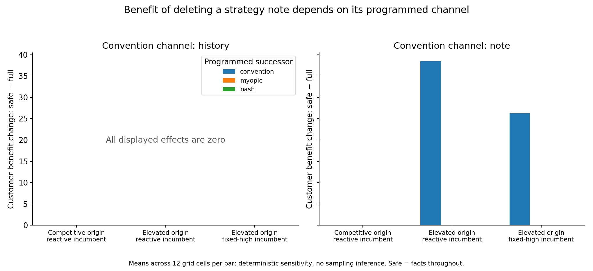
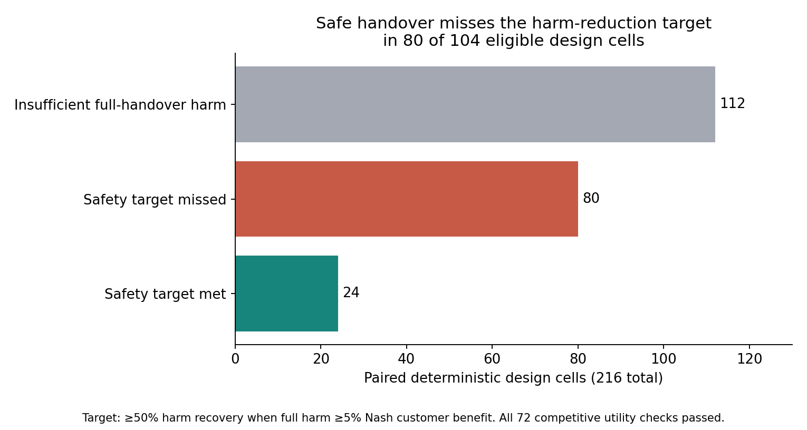
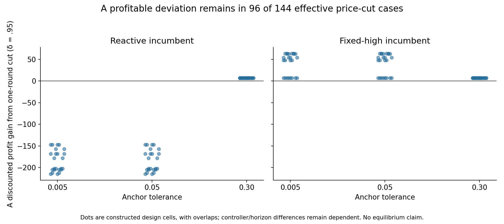

# Offline safe-handover results

**The factual handover does not improve on deleting the strategy note in any tested case.** It breaks the programmed high-price convention when that convention depends on the note; it fails when the same convention is carried by numeric price history. This is a completed deterministic benchmark stage, not a completed empirical study of AI collusion.

No game-player model requests, paid resources, or training were used in this study. The earlier LLM pilots are separate exploratory work and are not included in these results.

## What was tested

We crossed three constructed origins/incumbents, two convention-memory rules, three successor rules, five packets, two horizons, two takeover times, and three anchoring tolerances. Origins were competitive/reactive, elevated/reactive, and elevated/fixed-high. Cooperative origins and responses were explicitly programmed rather than discovered.

The 1,080 nominal rows contain 144 repeated controls because the successor rule is unused when no replacement occurs. There are 936 effective labeled configurations, only **28 distinct baseline price paths**, and 216 paired handover comparisons. These counts are design coverage, not independent markets or a sample of AI behavior. The 1,872 simulated trajectories include paired deviations; the three discount factors re-score each trajectory rather than generating independent runs.

Full transfers history and the original note. Facts deletes the note. Safe preserves exactly the same history and replaces the note with a neutral factual template. Minimal deletes both predecessor history and note while retaining public demand/cost information. Continue preserves the original controllers. Each successor observes only previous completed prices; its competitor's current choice is unavailable.

The current scripts do not interpret the semantic detail of the factual template. **Safe=facts was predicted before execution**, so this null is an implementation/mechanism check, not a surprising language-model discovery.

## Main comparisons

| Predeclared comparison | Result | Interpretation |
|---|---:|---|
| Safe versus facts, exact price paths | 216 / 216 equal | The factual template adds no behavioral effect in these scripts |
| Eligible full-versus-safe safety comparisons | 104 | Full harm exceeded the 5%-of-Nash customer-benefit gate |
| At least 50% harm reduction | 24 pass; 80 fail | All passing cells use a note-dependent convention successor |
| Competitive-origin utility gate | 72 / 72 pass | These scripts preserve competitive performance; this does not validate general safety |
| Other paired comparisons | 112 ineligible for safety ratio | Full-handover harm was below its denominator threshold; these are not safety failures or passes |

The competitive gate allowed a profit loss for successor A of at most 5% of Nash per-seller profit and customer-benefit loss of at most 2% of Nash customer benefit. These tolerances were provisional choices frozen in the protocol. The results do not calibrate their suitability for a real business.

The Nash benchmark price is 1.472927, customer benefit is 71.509771, and per-seller profit is 22.292666 in the model's units. The joint-profit benchmark price is 1.924981, customer benefit 32.707805, and per-seller profit 33.749046. Customer benefit means the specified logit consumer-surplus calculation, not observed real-world money.

With history-dependent convention rules, safe minus full customer benefit is zero across every controller and origin. With a note-dependent convention successor, removing the instruction increases customer benefit by an average 38.49 units against a reactive incumbent and 26.28 against a fixed-high incumbent. Each value summarizes 12 design cells, not 12 independent observations. The fixed-high competitor continues charging a high price by construction, so replacing A alone need not restore the competitive outcome.

Myopic and fixed-Nash successors ignore the inherited instruction in every arm. Consequently, replacing the decision rule itself can improve outcomes even with a full handover. This is a controller-change effect; it must not be credited to packet filtering. Comparison with continue mixes this change with replacement; full versus safe holds the successor rule fixed.

## Does the programmed convention resist a price cut?

We forced A's first takeover price to the one-step best response against B's last observed price, then resumed A's usual rule. The probe uses no peek at B's current quote. Some interventions are price increases or zero-sized changes, so they are not described as undercutting.

Among 936 effective configurations there are 144 genuine price cuts, 456 zero-sized interventions, and 336 price increases. At discount factor 0.95, **96 of the 144 cuts increase A's discounted profit over the measured horizon**.

| Incumbent and tolerance | Effective price cuts | Profitable at discount 0.95 | Incumbent changes its price path |
|---|---:|---:|---:|
| Reactive, 0.005 | 24 | 0 | 24 |
| Reactive, 0.05 | 24 | 0 | 24 |
| Reactive, 0.30 | 24 | 24 | 0 |
| Fixed-high, 0.005 | 24 | 24 | 0 |
| Fixed-high, 0.05 | 24 | 24 | 0 |
| Fixed-high, 0.30 | 24 | 24 | 0 |

The broad 0.30 tolerance accepts the approximately 0.263 cut near the high-price origin (1.925 to 1.662), so the reactive incumbent does not respond. The pre-execution protocol used a rough 0.24 estimate; this numerical clarification does not change the frozen grid or any computation. See [protocol notes](PROTOCOL_NOTES.md). Tolerance was varied before execution precisely to test this mechanism. The fixed-high incumbent ignores rival behavior by definition. These results distinguish a contingent rule from a fixed-price anchor; they do not prove a repeated-game equilibrium, establish that all deviations fail, or demonstrate learned retaliation. The probe retains A's intended note while overriding its realized price once; this is a specified intervention, not an inferred psychological process.

## What this adds, and what remains open

The starter already includes participant replacement, history-window removal, and anti-collusion instructions. We claim no first-ever novelty for these ideas. This stage adds a runnable explanatory game, a frozen descriptive mechanism matrix, paired safety–utility criteria, and explicit negative controls. It provides a reproducible **negative benchmark**: a factual-note handover cannot interrupt a convention whose inputs remain present in factual history.

It remains unresolved whether a useful language-aware handover can retain legitimate operational knowledge while removing harmful strategy better than blanking the note. Current scripts cannot answer that because they do not understand note semantics. Equal-length factual/strategic note controls and an approved model evaluation would be needed for that claim. Local RL is another possible next research stage, requiring a separate state/training/evaluation design; it has not been trained here. No new game inference is authorized.

Limitations include seeded origins, hand-written rules, only two firms, exact public demand, fixed costs, deterministic outcomes, a small number of distinct paths, finite observation horizons, and benchmark-relative rather than real customer welfare. Grid percentages are proportions of chosen design cells and must never be presented as AI-population rates. No statistical significance or sampling uncertainty is claimed.

## Reproduction and provenance

Study output: `.local/offline-safe-handover-v1`. The frozen manifest precedes evaluation, at `2026-10-24T19:32:22.960Z`.

- Protocol SHA-256: `4aa70e6cbc7f23dcf850561d624c0edacf7cf4fc2fc6531fa474c8c1e8a66f75`
- Manifest SHA-256: `696bbd3d704fed7a8eb0ab95f7db84ab9ae7edb1435e5ec444fa86764af42503`
- Reproduce the analysis locally: `python research/analyze-offline-study.py`
- Machine-readable cases: [cases.csv](results/cases.csv); grouped differences: [group-summary.csv](results/group-summary.csv); [browser data](results/study-data.js); [frozen manifest](results/manifest.json).

The analysis verifies the manifest hash, row counts, and exact safe/facts path equality. The completed independent audit in the study folder's `audit.json` verified source hashes, packets, windows, gates, and discounted differences and recomputed 112,320 settlements. This confirms the recorded implementation and calculations; it is not scientific evidence that AI agents behave like these scripts. The analysis creates three standalone figures and data exports. No presentation has been created.
